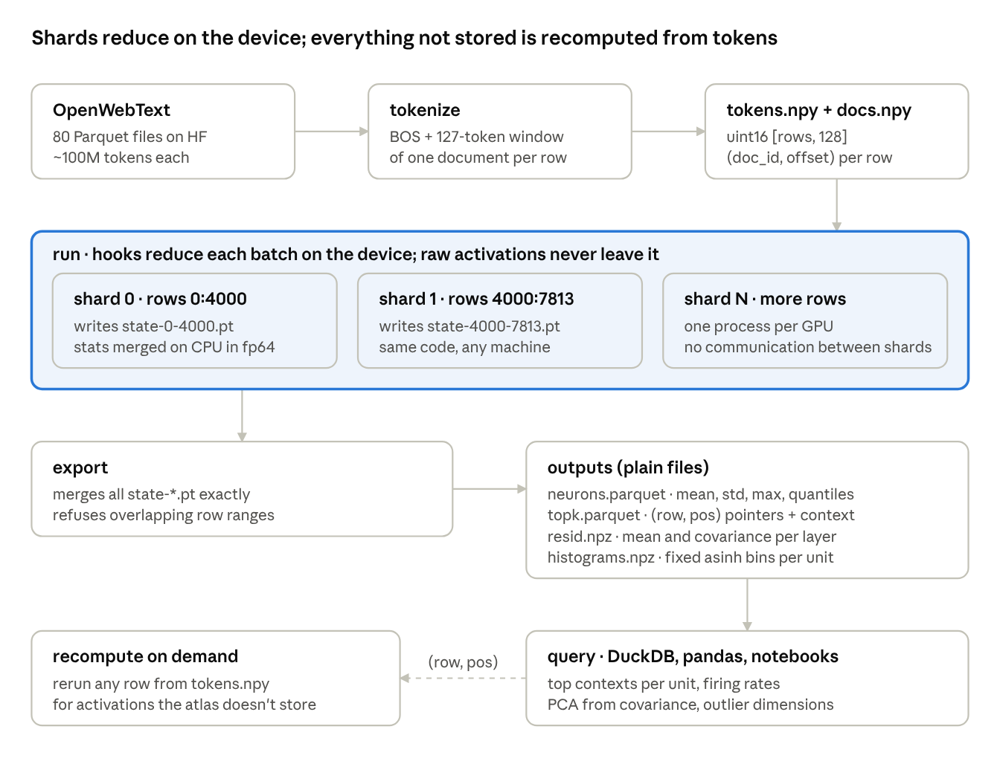
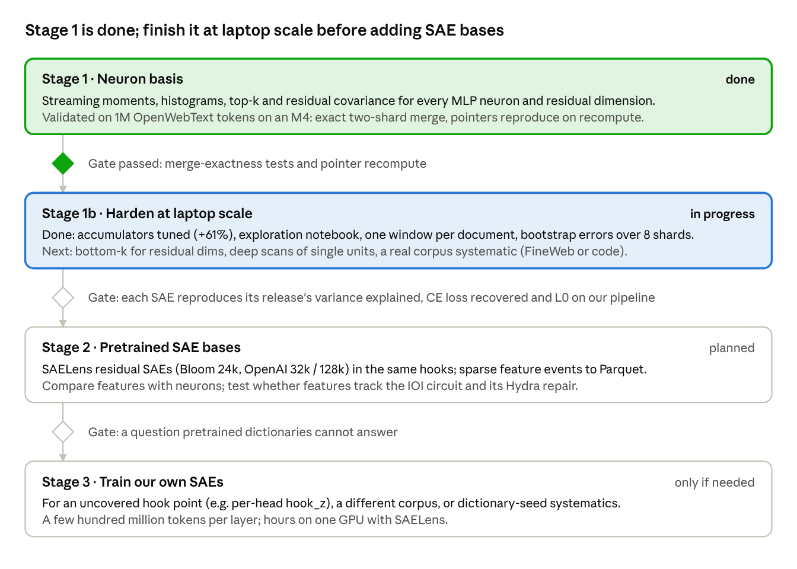

# GPT-2 Activation Atlas — Design Doc

*Ryan Reece, 2026-10-22, updated 2026-10-25. Living version: [Claude Doc](https://claude.ai/artifact/4UKoy7XmiR5BfQKNthvETu).*

## Summary

We are building a queryable atlas of what every unit in GPT-2 small does over a large text corpus: per-unit statistics, top-activating contexts and residual-stream geometry, first in the neuron basis and then in pretrained SAE feature bases. Stage 1 works end to end: 1M OpenWebText tokens on an M4 laptop, in two shards merged exactly, with every stored exemplar reproducing its activation on recompute.

The atlas grows out of ioi-hydra, a replication of the IOI circuit and its Hydra-effect self-repair. That project cached every activation for 128 prompts. The atlas asks the same kind of questions over 10M–100M+ tokens, where caching everything is impossible, so the whole design is built around streaming reductions instead.

## Goals and non-goals

The atlas should answer "what does this unit respond to, how often, and how strongly?" for any unit in seconds, with numbers that are reproducible and carry known uncertainties.

**Goals**

- Per-unit summaries for every MLP neuron (12 × 3072) and residual dimension (13 × 768): count, mean, std, max, firing rate, quantiles, histogram.
- Top-k exemplars per unit, stored as pointers into the token stream and shown with decoded context.
- Residual-stream mean and covariance per layer, for PCA, whitening and outlier dimensions.
- The same outputs in SAE feature bases (stage 2), so neurons and features can be compared side by side.
- Horizontal scaling: shards run on any number of machines and merge exactly.
- Every number traceable to a model revision, corpus shard, code commit and processing convention.

**Non-goals**

- Live production monitoring. That is a separate design: in-graph probes inside the serving engine (see the vLLM notes from 2026-10-21).
- Storing raw dense activations. If something isn't in the atlas, recompute it from tokens.
- Models other than GPT-2 small, for now. Nothing should hard-code GPT-2 beyond the default hook list.
- Duplicating Neuronpedia. Where it already hosts dashboards for a dictionary, we use its outputs and spend our effort on what's missing: systematics and comparisons across dictionaries.

## Design principles

Activations are a pure function of (weights, tokens), so we keep tokens plus reductions and recompute everything else. The rest of the design follows from that.

1. **Store reductions and pointers, not tensors.** Dense activations for 1B tokens are about 20 TB for the residual stream alone and roughly 300 PB for every hook point. An exemplar is a `(row, pos)` pointer into `tokens.npy` (uint16, 2 bytes per token); rerunning one row costs milliseconds.
2. **Reduce on the device.** Hooks reduce each batch on the GPU; only small summaries cross to the CPU. The host transfer, not FLOPs, is the bottleneck to avoid.
3. **Every accumulator merges exactly.** Moments and covariance use Chan et al.'s parallel formulas in float64; histograms use fixed edges; top-k merges by re-selecting. Shard A plus shard B equals one pass over A + B, so scaling out is map-reduce.
4. **Pin conventions and record provenance.** Activations follow TransformerLens's processed convention (folded LayerNorm, centered writing weights), matching HookedTransformer and therefore the pretrained SAEs, whichever backend computes them. Each state file records its row range, git commit, torch version and model.
5. **Exclude known artefacts explicitly.** Position 0 (BOS) is an attention sink whose residual norm is orders of magnitude above the rest, so it is dropped from all statistics rather than left to dominate them.
6. **Query with plain files.** Outputs are Parquet and npz, queried with DuckDB or pandas. There is no database server to run.

## Architecture

The pipeline is three commands over plain files: `tokenize` once, `run` per shard anywhere, `export` to merge.

**Data model.** A *row* is one sequence the model processes independently: BOS plus 127 consecutive tokens from one document. A *pointer* is `(row, pos)`, stored as the integer `row × 128 + pos`; positions 1–127 are real tokens. Shards are row ranges, so a shard's state is self-describing and any set of non-overlapping shards merges into one atlas.

**Hook points (stage 1).** MLP `hook_post` in all 12 layers (3072 units each) and the residual stream at 13 points: `hook_resid_pre` for layers 0–11 plus the final `hook_resid_post`. The forward pass stops after the last hook, so no layer past it runs. Stage 2 adds an SAE encoder inside the same hooks and writes sparse `(row, pos, layer, feature, value)` events.

**Model backends.** The default backend, `HFGPT2`, is plain Hugging Face `GPT2Model` (no LM head, so no unembed) with PyTorch forward hooks, exposed under TransformerLens hook names. Compatibility mode changes only one thing the atlas reads: everything written to the residual stream has its per-token mean over d_model removed, because centering the writing weights is linear. `HFGPT2` applies that one subtraction. `TLGPT2`, the TransformerLens bridge, is kept as the reference, and `tests/test_backends.py` holds the two equal at every hook point. TransformerLens stays the tool for circuit work (patching, per-head outputs, direct logit attribution), where it saves real effort.

## Stage 1 status

Stage 1 is built and validated on 1M tokens, with both backends. The code lives in `python/atlas.py` (CLI `python -m atlas`, `--backend hf|tl`), `scripts/run-atlas`, `tests/test_atlas.py` and `tests/test_backends.py`.

**Validation**

| Check | Result |
| --- | --- |
| Merge exactness (unit tests: moments, covariance, top-k, histogram, state round trip, tokenizer) | 6 of 6 pass; split vs. whole agree to float32 rounding (~1e-7 relative) |
| HF backend vs. TransformerLens bridge, per hook (7 hook types × layers 0, 5, 11, BOS included) | 21 of 21 agree within 2e-5 of the activation scale; raw HF residuals fail without centering, as they should |
| Full 1M-token atlas, HF vs. TL backend | means, stds, quantiles agree to ~1e-5 relative; largest difference in any unit's max is 2e-4; 0.6% of top-k pointers swap among exact ties (identical left contexts) |
| Pointers reproduce: recompute stored top-k entries from `(row, pos)` | 10 of 10 match to 5 decimals, layers 0, 9 and 11 |
| Two-shard run merged by `export` | 7,813 rows from shards 0:4000 and 4000:7813 |
| Residual stream behaves like known GPT-2 | variance grows ~5000× from layer 0 to the final residual; the largest-variance dimension is 480 in layers 1–7, 447 in layers 8–10 and 496 in layers 11–12; effective dimension peaks at ~170 in layers 7–9 and collapses to ~7 at the final residual |
| Neurons behave like known GPT-2 | rarely-firing neurons (firing rate < 1e-4) concentrate in layers 0–2: 63, 86, 21 |

**Measured cost (M4, MPS, 1M tokens)**

| Quantity | TL bridge | Plain HF (default) |
| --- | --- | --- |
| Forward pass with hooks on all 25 points | ~5,300 tok/s | ~9,600 tok/s |
| Full run, all accumulators | ~3,200 tok/s (before tuning) | ~5,150 tok/s after tuning (fused moments, int32 histograms, histograms on every 4th token) |
| Wall time for 1M tokens (run only) | ~5 min | ~3.2 min |
| State file per shard | 171 MB (histograms 97 MB, covariance 61 MB), independent of token count | same |

Tokenizing takes about 1 min and export 9 s with either backend.

**Known limitations**

- The accumulators still cost about as much as the forward pass (full run ~5,150 vs ~9,700 tok/s forward-only on an M4): top-k and histograms each read every MLP activation. Histograms use every 4th token, which shifts quantiles by a median 0.02 std at p99 (0.13 std for the worst 1% of units). Further speed belongs on CUDA.
- 1M tokens come from only 909 documents, so exemplars cluster within documents.
- Top-k keeps only the largest values; residual dimensions need bottom-k too.
- Statistics cover positions 1–127 only. Behaviour that depends on long context is not seen.
- Rows start mid-document after a BOS, which GPT-2 never saw in training (its windows started mid-document without BOS).

## Roadmap

The next step is hardening and scaling stage 1, not adding SAEs: the pipeline is basis-independent, so anything fixed now carries over to every dictionary later.

Each stage reuses the same tokenize → run → export pipeline and only adds accumulators or a change of basis inside the hooks. The research payoff comes in stage 2: checking whether SAE features at layers 9–11 change under name-mover ablation the way the head-level Hydra accounting predicts.

## Systematics and validation plan

Atlas numbers are measurements conditional on a corpus, a convention and a dictionary; each of those is a systematic, reported as a spread next to the statistical error, as in ioi-hydra.

| Source | How we vary it | Applies from |
| --- | --- | --- |
| Statistical (finite tokens) | bootstrap over shards: the per-shard states are already the resampling units | stage 1 |
| Corpus | rerun on a second OpenWebText shard, then FineWeb or code | stage 1 |
| Context length and position | seq_len 128 vs. 512; statistics split by position bucket | stage 1 |
| Processing convention | compatibility mode on vs. raw HF weights (affects residual statistics only) | stage 1 |
| SAE dictionary | Bloom 24k vs. OpenAI 32k / 128k on the same layer: feature splitting and matching | stage 2 |
| SAE reconstruction error | report the unexplained variance ("dark matter") beside every feature-level claim | stage 2 |
| SAE seed | two trainings differing only in seed | stage 3 |

**Gates before trusting a pretrained SAE.** On our own pipeline, its variance explained, CE loss recovered, L0 and dead-feature fraction must match the release's reported numbers. A mismatch means a convention differs (hook name, LayerNorm folding, BOS handling), and the SAE's outputs would be quietly meaningless.

**Regression checks on every run.** Pointers must reproduce on recompute for a random sample of top-k entries, and residual outlier dimensions must stay stable across shards.

## Open questions

- [ ] **Who is the atlas for?** A personal research tool favours notebooks and DuckDB; a shared one needs a viewer (static HTML pages per unit, or uploads to Neuronpedia).
- [ ] **Compute for scaling.** Which CUDA machine runs the 100M-token stage, and is a SLURM array, Ray or plain shell loops enough for ~10–100 shards?
- [ ] **Row layout.** Keep per-document windows with BOS, or switch to GPT-2's training layout (contiguous 1024-token windows without BOS) for stage 3 onward?
- [ ] **Sequence length.** 128 keeps attention cheap and matches IOI-length prompts; 512 or 1024 sees long-context behaviour at 4–8× the attention cost.
- [ ] **Which hook points next.** Attention outputs per head (`hook_z`) would tie the atlas directly to the head-level IOI analysis.
- [ ] **Naming.** "row" is the array axis; "seq" may read better in code and Parquet columns.
