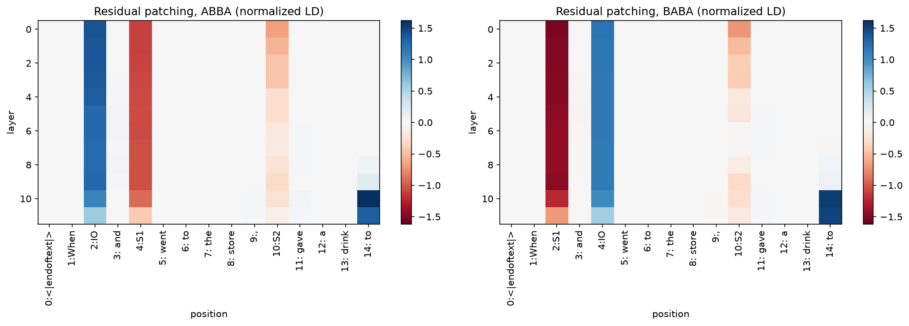
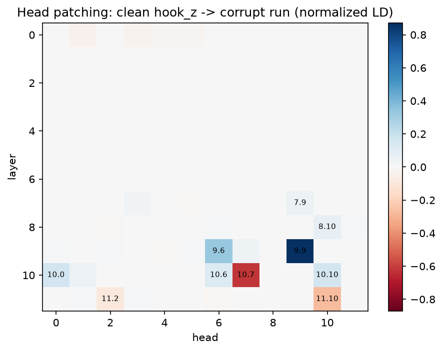
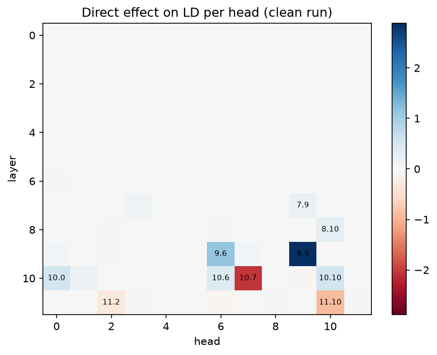
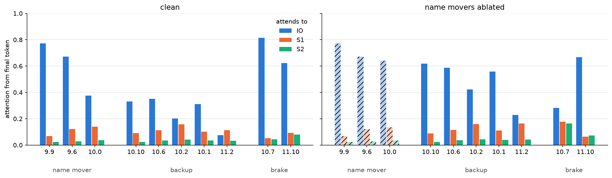
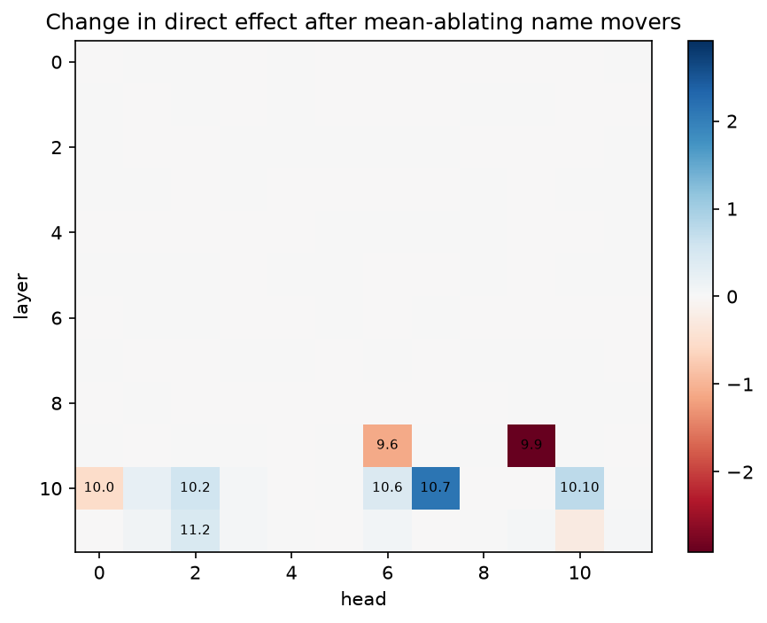
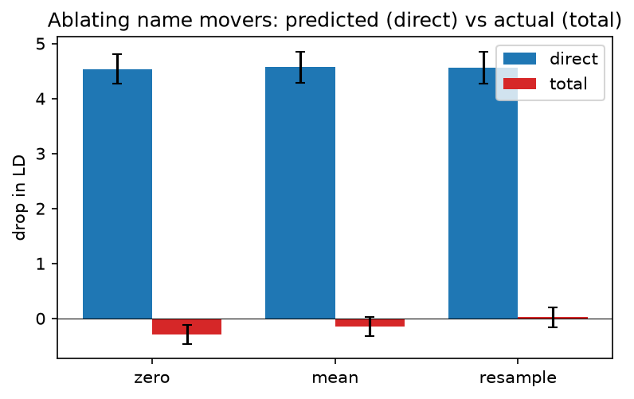
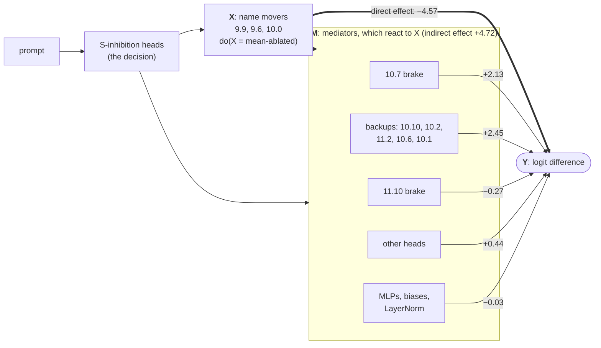

# Self-repair in GPT-2 small's IOI circuit

*Ryan Reece, 2026-10-04. All numbers are produced by [`notebooks/ioi_hydra.ipynb`](../notebooks/ioi_hydra.ipynb);
see [Reproducing](#reproducing).*

## Summary

GPT-2 small completes *"When Susan and Robert went to the store, Robert gave a drink to"* with *Susan*, using a
circuit found by [Wang et al. 2022](https://arxiv.org/abs/2211.00593). I replicated it with TransformerLens 4.x and
asked what happens when the heads that write the answer are removed
([McGrath et al. 2023, "The Hydra Effect"](https://arxiv.org/abs/2307.15771)). That this circuit self-repairs was
already known; what is new here is a complete accounting of the repair, with bootstrap CIs over prompts and a first
pass at systematics: ablation method, template and dataset seed (see
[Relation to prior work](#relation-to-prior-work)).

**Result.** Ablating the three name-mover heads removes 4.6 logits of direct effect, yet the logit difference does
not drop: the network repairs **103% [100%, 107%]** of the damage. This holds for zero, mean and resample ablation,
across 8 templates and 4 name samples.

**Mechanism.** The answer is a small difference between large opposing forces: the name movers push the correct name
up by about 4.5 logits while copy-suppression heads push it down by about 3.3. When the name movers are removed, the
brake (head 10.7) lets go, giving about 45% of the repair, and backup heads double their attention to the answer,
giving the other 55%. Attention heads account for all of it.

**Interpretation.** The circuit has an irreplaceable *decision* stage and a redundant, self-regulating *output*
stage. Removing the S-inhibition heads, which carry which name is repeated, drops the logit difference to near chance
with no repair. "Name mover", by contrast, is a role filled by a pool of heads, with negative feedback holding the
output steady.

**Lesson.** Direct effect, patching and ablation answer different questions, and here they disagree:

| tool | question | for the name movers |
|---|---|---|
| **direct effect on the logits** (DLA, §4) | who's *voting* for the answer? | they cast most of the votes |
| **denoising** (patching clean into corrupt, §2–§3) | who's *enough* to bring it back? | they're enough on their own |
| **ablation** (noising, §5–§7) | who's *needed*? | they aren't: others change their votes |

Heads also interact (redundancy, dependency, saturation), so any "component X explains Y%" decomposition depends on
the order of removal. Claims about component importance should report direct and total effects, several
counterfactuals, and interactions.

All uncertainties are 95% percentile-bootstrap intervals over prompts (5000 resamples). *N* = 128 prompts. The model
is deterministic, so these are purely statistical errors from sampling inputs. They are conditional on one model
(GPT-2 small), these 8 templates, the name pool and the ABC corruption. They treat prompts as independent, although
they cluster by template. Systematics are reported separately as spreads (§7), not folded into the intervals.
Whether the results generalize beyond this one model is not quantified.

## Relation to prior work

This study is a replication with quantitative extensions, not a new discovery. What each source contributes:

| work | setting | relevant finding |
|---|---|---|
| [Wang et al. 2022](https://arxiv.org/abs/2211.00593) | GPT-2 small, IOI | the circuit; backup name movers, found because knocking out the name movers did not break the task; negative name movers, which they speculate help the model "hedge" |
| [McGrath et al. 2023](https://arxiv.org/abs/2307.15771) | factual recall, ablating whole attention layers | the Hydra effect: when one attention layer is ablated, another compensates; late MLPs "downregulate the maximum-likelihood token"; this occurs "even in language models trained without any form of dropout" |
| [McDougall et al. 2023](https://arxiv.org/abs/2310.04625) | GPT-2 small, head 10.7 | copy suppression; "if an initial overconfident copier is ablated, then there is nothing to suppress"; copy suppression "explains 39% of the [self-repair] behavior in a narrow task" |
| [Rushing & Nanda 2024](https://arxiv.org/abs/2402.15390) | single attention heads, resample-ablated on the training distribution (The Pile); Pythia, GPT-2, Llama-7B | self-repair is general across model families and sizes, but "imperfect" and varies "significantly across different prompts"; measured as the change in the correct token's logit minus the change in the head's direct effect; LayerNorm rescaling "only explains up to around 30% of the self-repair on average"; sparse neurons perform "Anti-Erasure"; IOI's backup heads and copy suppression are cited as known instances |

**What is borrowed.** The circuit and its head roles come from Wang et al. The central measurement, direct versus
total effect of an ablation with the gap read as compensation, comes from McGrath et al., applied here at the level of
individual heads inside the IOI circuit rather than whole layers in a factual-recall setting. That the IOI circuit
self-repairs (Wang et al.) and that 10.7 contributes by having nothing left to suppress (McDougall et al.) were both
already known. So is the generality of the effect: Rushing & Nanda measure self-repair for single heads across models
and the full training distribution, with the same direct-minus-total definition (on one token's logit rather than a
logit difference), and find a LayerNorm share of up to about 30%.

**What this study adds.**
1. A complete accounting of the repair with uncertainties: every logit assigned to a component (§5 waterfall), with
   bootstrap CIs, and the natural direct effect measured by an explicit run with every mediator frozen. Where Rushing
   & Nanda give distributional statistics over many heads and tokens, this is a per-component account of one circuit.
   The 45% attributed to 10.7 is consistent with McDougall et al.'s 39%, measured on a different dataset with
   different accounting.
2. The counter-push from the later brake 11.10, which partly undoes the repair (§5).
3. Systematics: the repair fraction across ablation methods, templates and name samples, with the bootstrap errors
   checked against seed-to-seed variation (§7).
4. A measured taxonomy of head interactions (redundancy, dependency, saturation) with paired CIs (§6).
5. Methodological observations: with an ABC corruption, per-head denoising reduces to direct logit attribution
   (§3); normalized patching scores above 1 reveal an inhibitory process (§2); and plotting choices such as a clipped
   colour scale or averaging ABBA with BABA can hide the largest effects (§2).

## Setup

**Model.** GPT-2 small (124M), loaded with `TransformerBridge.boot_transformers("gpt2")` and
`enable_compatibility_mode()` (LayerNorm folded, so numbers match the legacy `HookedTransformer` and the papers).

**Prompts.** 8 templates × 16 prompts, balanced between ABBA and BABA name orders, using names that are a single
GPT-2 token.

| | example | answer |
|---|---|---|
| **clean** (ABBA) | When **Susan** and **Robert** went to the store, **Robert** gave a drink to | Susan |
| **clean** (BABA) | When **Jessica** and **Alice** went to the store, **Jessica** gave a drink to | Alice |
| **corrupt** (ABC) | When **Anthony** and **Betty** went to the store, **Thomas** gave a drink to | — |

Each clean prompt is paired with a corrupt prompt from the same template, with all three name slots replaced by
fresh, distinct names. It keeps the grammar, length and token positions but removes the one cue IOI depends on
(which name is repeated), making it the control sample for patching and ablation.

**Metric.** Logit difference LD = logit(IO) − logit(S) at the final token, always using the clean pair's IO and S.
Normalized LD rescales this so that corrupt = 0 and clean = 1.

**Ablations** replace a head's output (`hook_z`, at all positions) with:
- **zero**: 0
- **mean**: its mean over the corrupt prompts of the same template, per position (as in Wang et al.)
- **resample**: its value on the matched corrupt prompt

**Direct effect on the logits (DE)** of a component is how far its output, on its own, pushes the IO logit above
the S logit through the direct path to the unembedding. "DE" here always means the direct effect *on the logits*;
Wang et al. use "direct effect" relative to any receiver (the logits in their Fig 3b, the name movers' queries in
Fig 4b, the S-inhibition heads' values in Fig 5b). At the final position, the residual stream entering the final
LayerNorm is a sum of everything written into it:

$$x = \text{embeddings} + \sum_{\text{heads } h} o_h + \sum_{\text{MLPs } m} o_m + \text{biases}, \qquad o_h = z_h W_O^{h}$$

where $z_h$ is head $h$'s output (`hook_z`) at the final position and $W_O^{h}$ its output projection. With
compatibility mode, the LayerNorm weight and bias are folded into $W_U$ and $b_U$, so the final LayerNorm is just
centering and scaling:

$$\text{LN}(x) = \frac{x - \bar{x}}{\sigma(x)}, \qquad \text{logits} = \text{LN}(x)\, W_U + b_U$$

where $\bar{x}$ is the mean over the 768 dimensions and $\sigma(x)$ the LayerNorm scale. Writing
$\Delta w = W_U[:, \text{IO}] - W_U[:, \text{S}]$, the logit difference is

$$LD = \frac{(x - \bar{x}) \cdot \Delta w}{\sigma(x)} + (b_U[\text{IO}] - b_U[\text{S}])$$

Centering is linear, so for a fixed $\sigma$ this splits exactly into one term per component:

$$LD = \sum_{c} DE_c + (b_U[\text{IO}] - b_U[\text{S}]), \qquad DE_c = \frac{(o_c - \bar{o}_c) \cdot \Delta w}{\sigma(x)}$$

Every component shares the denominator $\sigma(x)$ of the run being analysed (clean or ablated). A component that
changes the answer by changing what later components do has an indirect effect that DE does not see. Implemented in
`head_direct_effects` in [`python/ioi_hydra.py`](../python/ioi_hydra.py).

## Results

### 1. Baseline

| | LD |
|---|---|
| clean | **3.38** [3.14, 3.61], with LD > 0 on 99.2% of prompts |
| corrupt | **−0.05** [−0.33, 0.24] |

This matches the ~3.5 reported by Wang et al. The corrupt prompts carry no IOI information, as designed.

**Template spread is a systematic.** Per-template LD ranges from 2.25 [1.78, 2.77] (*"The local big house where A
and B lived was quiet. S handed a key to"*) to 4.15 [3.39, 4.92] (*"When A and B went to the park, S gave a ball
to"*), well beyond the per-template statistical error, so a single-template study would understate the uncertainty
on the baseline.

### 2. Residual-stream patching



Clean `resid_pre` is patched into the corrupt run at one (layer, position) at a time, using template 0 only so that
positions line up, with ABBA and BABA plotted separately because the IO and S1 slots swap between them. Each panel is
normalized by its own clean and corrupt LD; values above 1 mean the patch does *better* than the clean run.

- **The answer reaches the final token (`to`) at layers 9–10, and overshoots.** Patching that position does nothing
  before layer 8, recovers 0.04–0.19 at layers 8–9, then jumps to **1.62 (ABBA) / 1.53 (BABA)** at layer 10 and
  1.33 / 1.50 at layer 11. The patched state carries the answer, but the brakes 10.7 and 11.10 suppress a name by
  attending to it in the context, and the corrupt context gives them nothing to grip (§4, §5).
- **Single name positions carry the largest effects, ±1.1 to 1.5.** Patching the IO slot puts the IO name into the
  corrupt context once and the model copies it; patching S1 does the same for S. Both fade at layers 10–11, after
  the name movers have read those positions. Averaging ABBA with BABA would cancel these effects.
- **The S2 column traces the circuit's timing.** Patching S2 (the repeated name) gives −0.66 (ABBA) / −0.71 (BABA)
  at layer 0, −0.15 / −0.01 by layer 7, −0.31 at layer 9, and fades at layer 11. A reading that fits the layer timing
  but is not directly tested: early on, the patch inserts only the *token* S, which the model copies; by layers 5–7
  it also carries the "this name is a repeat" flag that the S-inhibition heads (layers 7–8) read; from layer 8 on, the
  flag arrives too late to be read, but the token is still there for the name movers to copy.
- **This is partly an artifact of the corruption.** ABC changes both the repetition and the name tokens, so patching
  a name position also inserts a name. An ABB → ABA corruption, which flips which name is repeated while keeping the
  same names, would isolate the repetition cue.

### 3. Per-head patching



Each head's clean output (all positions) is patched into the corrupt run (denoising).

| head | role (Wang et al.) | normalized LD recovered |
|---|---|---|
| 9.9 | name mover | **0.87** [0.78, 0.97] |
| 9.6 | name mover | 0.33 [0.25, 0.41] |
| 10.0 | name mover | 0.17 [0.08, 0.25] |
| 10.10 | backup name mover | 0.16 [0.08, 0.24] |
| 10.6 | backup name mover | 0.12 [0.03, 0.21] |
| 8.10, 7.9, 7.3 | S-inhibition | 0.03–0.07, consistent with 0 |
| 11.10 | negative name mover | −0.27 [−0.37, −0.18] |
| 10.7 | negative name mover | **−0.62** [−0.72, −0.53] |

**Here, a head's patching effect equals its direct effect.** Across all 144 heads, patching ≈ DE / 3.43 with
correlation 0.998 (9.9: 0.87 vs 0.84; 10.7: −0.62 vs −0.60), which is why this heatmap matches the one in §4.
Patching head $h$ changes LD by a direct part plus a downstream reaction:

$$LD_{\text{patched}} - LD_{\text{corrupt}} = \big(DE_h^{\text{clean}} - DE_h^{\text{corrupt}}\big) + \Delta_{\text{downstream}} \approx DE_h^{\text{clean}}$$

Both extra terms are about zero because the corrupt context contains neither IO nor S: the head's corrupt-run output
copies other names, and after the patch the backups have nothing relevant to copy and the brakes nothing to
suppress. Direct effects add, so the signed sum of patching values over all heads (each against its own prompt's
corrupt LD) is 0.84 [0.70, 0.98]. Per-head denoising into an ABC context therefore measures direct contribution, not
the network's response. Contrast §5: mean-ablating 9.9 alone drops LD by only 0.34 [0.23, 0.44] despite its DE of
2.89.

**Denoising measures sufficiency, not necessity.** The S-inhibition heads barely register here, yet ablating them
drops LD by 3.0 (§6). Their "don't attend to S" signal does nothing in a run where IO and S never appear. The
circuit behaves like an AND gate, so a head can be essential without being sufficient on its own.

### 4. Direct logit attribution (direct effect on the logits)



Wang et al.'s Fig 3b shows the same heads with the opposite sign and in percent: it patches each head's direct path
to the logits with its ABC activation in a clean run and plots the change in LD relative to clean LD, so

$$\text{Fig 3b} \approx \frac{DE_h^{\text{ABC}} - DE_h^{\text{clean}}}{LD^{\text{clean}}} \approx -\frac{DE_h^{\text{clean}}}{LD^{\text{clean}}}$$

(e.g. 10.0: +0.53 logits here, about −16% there).

| head | role | DE (logits) | attention END → IO | attention END → S1 | copy score | negative copy score |
|---|---|---|---|---|---|---|
| 9.9 | name mover | **+2.89** [2.71, 3.07] | 0.77 | 0.07 | **1.00** | 0.00 |
| 9.6 | name mover | +1.12 [1.00, 1.25] | 0.67 | 0.12 | 0.90 | 0.00 |
| 10.0 | name mover | +0.53 [0.40, 0.66] | 0.37 | 0.14 | 0.74 | 0.00 |
| 10.10 | backup | +0.55 [0.46, 0.65] | 0.33 | 0.09 | 0.52 | 0.00 |
| 10.6 | backup | +0.39 [0.28, 0.50] | 0.35 | 0.11 | 0.62 | 0.00 |
| 10.2 | backup | +0.01 | 0.20 | 0.16 | 1.00 | 0.00 |
| 10.1 | backup | +0.16 | 0.31 | 0.10 | 0.09 | 0.00 |
| 11.2 | backup | −0.30 [−0.37, −0.23] | 0.08 | 0.11 | 0.92 | 0.00 |
| 10.7 | brake | **−2.06** [−2.20, −1.92] | **0.81** | 0.05 | 0.00 | **0.98** |
| 11.10 | brake | −0.92 [−1.01, −0.82] | 0.62 | 0.09 | 0.00 | **1.00** |

The **copy score** applies the head's OV circuit to the residual stream at the IO position, as the head reads it,
and unembeds: this is what the head would write if it attended fully to the IO name. It is the fraction of prompts
where the IO token is among the 5 highest of all 50,257 logits; the negative copy score, among the 5 lowest (Wang et
al.).

A **name mover** attends to the IO name from the final position *and* copies what it reads. The brakes attend to the
same name and anti-copy it, writing it as their most suppressed token: copy suppression
([McDougall et al. 2023](https://arxiv.org/abs/2310.04625)). Copying alone is not enough: 6.9, 7.2, 7.10 and 8.11 also
have copy scores above 0.9 but do not attend to IO from the final token. 11.2 copies but attends slightly more to S1,
so its DE is negative; 10.1 attends to IO but barely copies (0.09), so this test does not explain its DE.

**Attention**, in the clean run and with the name movers mean-ablated (§5; ablated heads hatched, since their
outputs are replaced):



With the name movers removed, every backup roughly doubles its attention to IO and the brake 10.7 drops from 0.81 to
0.28, spreading its attention to S1 and S2: the repair mechanism of §5, seen in where the heads look. 9.9's and 9.6's
attention is unchanged by the ablation; 10.0's rises from 0.37 to 0.64 because it reads layer 9's output.

**The output is a small difference between large opposing terms.** The three name movers contribute +4.5
directly, more than the total LD of 3.4; the negative heads subtract about 3. Remove one side, and the other can ease
off.

### 5. The Hydra effect

Mean-ablate the name movers {9.9, 9.6, 10.0}. If the network were a sum of independent parts, LD would fall by the
direct effect those heads lose. What actually happens:

| | drop in LD |
|---|---|
| **direct** (naive prediction) = Σ<sub>ablated</sub> (DE<sub>clean</sub> − DE<sub>ablated</sub>) | **4.57** [4.29, 4.85] |
| **total** (actual) = LD<sub>clean</sub> − LD<sub>ablated</sub> | **−0.15** [−0.33, 0.02] |
| **repair fraction** = (direct − total) / direct | **1.03** [1.00, 1.07] |
| **natural direct effect**, exact run: ablate with every other component frozen at its clean value | 4.57 [4.29, 4.84] |

The last row checks the first. The naive prediction comes from direct-effect accounting, which divides by the
ablated run's final-LayerNorm scale. Re-running the ablation with every other head's output, every MLP output and the
final-LN scale held at their clean values, so that nothing can react, gives the same number to within 0.003 logits.
The two agree because a mean-ablated name mover's direct effect is about zero, so the scale it is divided by hardly
matters. The naive prediction is therefore the exact no-feedback counterfactual, not an approximation of it (see
[causal mediation](#the-study-as-causal-mediation-analysis)).



Each cell is $\Delta DE_h = DE_h^{\text{ablated}} - DE_h^{\text{clean}}$, in logits and averaged over prompts: blue
means the head pushes LD up more than before, red that it pushes LD down more. It shows the *change*, not the
contribution: 10.7 is blue because it stops braking (−2.06 → +0.07). Heads in layers 0–9 run before or alongside the
ablated heads, so they are white by construction; only layers 10–11 can respond.

**Full accounting.** LD splits exactly into per-component direct effects in every run, so the change in LD splits
exactly into the ΔDEs. Starting at the clean LD and stepping through each group's change:


The brake releasing (+2.13) and the backups stepping up (+2.45: 10.10, 10.2, 11.2, 10.6, 10.1) together more than
replace the name movers' −4.57. The later brake 11.10 takes back 0.27, the remaining heads add 0.44, and MLPs,
biases and LayerNorm change it by −0.03, ending at 3.53, slightly above the clean 3.38. The repair is therefore
done by attention heads: the final LayerNorm scale drops by about 6% (17.8 → 16.6), slightly inflating every head's
DE, but the non-head remainder is only −0.03.

**Which heads respond**, with the change in their attention from the final token to the IO name:

| head | ΔDE | DE clean → ablated | attention END → IO, clean → ablated | what changed |
|---|---|---|---|---|
| 10.7 | **+2.13** [1.98, 2.27] | −2.06 → +0.07 | 0.81 → **0.28** | the brake releases |
| 10.10 | +0.77 [0.69, 0.86] | +0.55 → +1.32 | 0.33 → 0.62 | backup steps up |
| 10.2 | +0.58 [0.50, 0.65] | +0.01 → +0.59 | 0.20 → 0.42 | backup wakes up |
| 11.2 | +0.45 [0.34, 0.57] | −0.30 → +0.16 | 0.08 → 0.23 | from braking to helping |
| 10.6 | +0.41 [0.36, 0.46] | +0.39 → +0.80 | 0.35 → 0.59 | backup steps up |
| 10.1 | +0.24 [0.19, 0.28] | +0.16 → +0.40 | 0.31 → 0.56 | backup steps up |
| 11.10 | **−0.27** | −0.92 → −1.19 | 0.62 → 0.67 | the later brake tightens |

Three mechanisms are visible (see also the attention figure in §4):

1. **The brake releases (10.7), about 45% of the repair.** Copy suppression attends to the name currently being
   predicted and pushes it down. Without the name movers, Susan is not strongly predicted when layer 10 runs, so
   10.7 stops attending to her and its suppression vanishes. This is the same mechanism as the overshoot in §2.
   McDougall et al. attribute 39% of self-repair to copy suppression in their narrow task, consistent with 45% here.
2. **The backups step up, about 55%.** Each backup roughly doubles its attention to the IO name, and its direct
   effect doubles with it. *Why* their attention increases is not shown by these measurements; path patching would
   test whether the name movers' output normally dampens the backups' queries.
3. **A later brake pushes back (11.10).** It runs after the layer-10 backups. Once they have pushed Susan back up,
   it brakes slightly harder. The repair is the net result of several opposing feedbacks, not a simple restoration.

### 6. Additivity

§5 showed one kind of non-additivity: direct ≠ total, because the network adjusts downstream. Here is the other:
whether ablating heads one at a time adds up to ablating them together, i.e. whether the heads interact.
Interaction = Σ single drops − joint drop, with a paired bootstrap. Mean ablation shown; zero and resample agree to
within about 0.3 (see the notebook).

| head set | Σ single drops | joint drop | interaction | kind |
|---|---|---|---|---|
| name movers | 0.10 [−0.06, 0.27] | −0.15 [−0.33, 0.02] | +0.26 [0.18, 0.33] | small: each is backed up, alone or together |
| name movers + negative NMs | −2.45 [−2.70, −2.19] | −1.18 [−1.41, −0.95] | **−1.26** [−1.41, −1.11] | **dependency**: the brakes alone raise LD by about 2.55 (= −2.45 − 0.10), but once the name movers are gone 10.7 has already released |
| name movers + backup NMs | 0.43 [0.24, 0.62] | 1.58 [1.29, 1.90] | **−1.16** [−1.37, −0.95] | **redundancy** |
| S-inhibition | 3.65 [3.34, 3.96] | 3.05 [2.82, 3.27] | +0.60 [0.48, 0.73] | **saturation** |

| kind | signature | example | intuition |
|---|---|---|---|
| **redundancy** | joint > Σ singles | name movers + backups | spare capacity: each part is covered until you remove them all |
| **dependency** | one effect is conditional on another | name movers + brakes | the brake only acts when there's something to brake |
| **saturation** | joint < Σ singles | S-inhibition | a floor: you can't lose more than everything |

Without the interaction term, single-factor or sequential decompositions of a network's behaviour can be badly
wrong, in either direction.

### 7. Systematics



**Reading the figure.** The blue bar (direct) is the drop LD would show if nothing else reacted: the null hypothesis
of no compensation. The red bar (total) is the drop that actually happens; the gap is the repair. The blue bars are
the same height for all three methods (4.54–4.57, ≈ 2.89 + 1.12 + 0.53) because no replacement carries information
about IO vs S, so the blue bar is effectively a fixed reference. The result is that the red bar is about 0 however
the heads are removed.

| | control-systems term | here |
|---|---|---|
| **direct** (blue) | open-loop response: feedback switched off | −4.6 logits |
| **total** (red) | closed-loop response: feedback on | about 0 |
| **repair fraction** | how well the feedback regulates | about 1.0: complete regulation |

The brake releasing and the backups stepping up (§5) are the feedback. The blue bar is the exact open-loop
response: freezing every other activation at its clean value before ablating reproduces it to within 0.003 logits for
all three methods (zero −4.54, mean −4.57, resample −4.56).

| variation | repair fraction |
|---|---|
| ablation method: zero / mean / resample | 1.06 [1.02, 1.10] / 1.03 [1.00, 1.07] / 1.00 [0.96, 1.04] |
| template (8 templates) | 0.97 – 1.13, each about ±0.1 |
| dataset seed (seeds 1–3; seed 0 above) | 1.04, 1.03, 1.02, each about ±0.04 |

Zero ablation over-repairs most, consistent with it pushing activations furthest off-distribution.

**Why vary the ablation method.** "Remove a head" always means "replace its output with something", and each choice
asks a different counterfactual question. Self-repair is a claim about how downstream heads *react*, exactly the kind
of result an unnatural replacement could fake: downstream heads might respond to the unnaturalness of the input
rather than to the missing information. The repair fraction held across all three methods.

**Not yet varied**, roughly in order of expected importance:

| systematic | why it could matter |
|---|---|
| the corruption behind mean and resample ablation (ABC) | it defines what "no information" means; an ABB → ABA corruption could change the reference values |
| which positions are ablated (all positions vs the final token only) | name movers act at the final token; ablating everywhere also changes what they write elsewhere |
| which heads count as name movers | including 10.10 or 10.6 changes what is left to compensate (§6 shows this matters) |
| the LayerNorm-scale convention in DE | could shift credit between heads; freezing the scale would settle it |
| the metric (LD vs log-probability of IO) | LD cancels the softmax denominator; probabilities would behave differently |
| the bootstrap (over prompts vs over templates, then prompts) | a hierarchical bootstrap would give wider, more honest intervals |
| the model | whether repair is this complete in other sizes or training runs is the biggest open question |

## Conclusions

1. **The IOI circuit's output stage replicates** in TransformerLens 4.x: LD 3.38 (Wang et al.: ~3.55), the same name
   movers, brakes and backups, and the answer arriving at layers 9–10 (§1–§4). The S-inhibition heads are confirmed
   necessary but not examined, and the early duplicate-detection heads are not tested. The mechanism is closer to
   "predict the name in context that isn't repeated" than to grammatical indirect-object detection (§2).
2. **The answer is a balance of opposing forces:** about +4.5 logits from the name movers against −3.3 from the
   brakes. With nothing to brake, the model overshoots the clean run by 50–60% (§2, §4).
3. **Self-repair is complete, robust, and done by attention heads:** 1.03 [1.00, 1.07], about 45% from 10.7
   releasing and 55% from backups, slightly offset by 11.10 (§5, §7).
4. **A component's importance depends on the question and on what else is present.** The three tools disagree
   (tables below), and heads interact: removing both brakes raises LD by about 2.5 with the name movers present but
   by about 1.0 without them (§6). Credit assignment is order-dependent; Shapley values are the principled alternative.
5. **The measurement design shapes what is found.** With an ABC corruption, per-head denoising reduces to direct
   logit attribution; scores above 1 revealed an inhibitory process; a clipped colour scale and ABBA/BABA averaging
   had hidden the largest effects; templates move the baseline but not the repair fraction (§1–§3, §7).
6. **For interpretability practice:** report direct and total effects, several counterfactuals, and interactions.
   An automated agent ranking components by single-head ablation would call the name movers unimportant, and
   steering or suppressing features can likewise be compensated downstream, so effects should be measured end to end.

### Interpreting the repair

A circuit is usually presented as *the* pathway for a behaviour, yet removing its main output heads leaves the
behaviour unchanged. The data resolve this as follows:

- **The decision is not redundant; the output stage is.** Removing the S-inhibition heads, which carry which name is
  repeated, drops LD by 3.05 to near chance, and nothing repairs it. Removing the name movers, which write the
  answer, costs nothing. The network has one path for the computation and many paths for the output.
- **"Name mover" is a role, not a head.** At least seven heads (9.9, 9.6, 10.0, 10.10, 10.6, 10.2, 11.2) attend to
  the non-repeated name and copy it (copy score ≥ 0.5, §4). Normally 9.9 does most of the work; when it is removed,
  the others roughly double their attention to the IO name. The circuit is better described as a graph of roles,
  each filled by a pool of heads of different strengths (degeneracy, in biological terms), than as a list of heads.
- **The output is regulated, not just computed.** The copy-suppression heads act as negative feedback on the
  predicted name's logit, plausibly for calibration. When the name movers stop pushing, the brake eases off, which
  accounts for about 45% of the repair. Robustness to ablation may be a side effect of this calibration rather than
  something selected for directly. What causes the redundancy in training (dropout is one hypothesis) is not
  addressed here.

This is where Wang et al.'s criteria for a circuit (faithful, complete, minimal) come apart: a circuit without the
backups looks complete until the name movers are ablated. Any method that judges a component's importance by
removing it will misjudge the output stage.

### The study as causal mediation analysis

The Hydra measurement is a mediation analysis in Pearl's sense ([Pearl 2001](https://arxiv.org/abs/1301.2300), "Direct and Indirect Effects"). The
network is a deterministic structural causal model, the prompts are the population, and all effects are averaged
over prompts:

- **treatment** $X$: the name movers' output, clean ($x$) or mean-ablated ($x'$)
- **mediators** $M$: everything downstream that can react (10.7, the backups, 11.10, …)
- **outcome** $Y$: the logit difference



Edge labels are changes in LD when the name movers are ablated, taken from the §5 waterfall. The thick edge is the
direct path; the mediator edges sum to the indirect effect, and the two together give the total effect, +0.15. The
mediators also read the upstream decision and each other (layer 10 feeds layer 11); those edges are not drawn.

Writing $Y(x, m)$ for the outcome with treatment $x$ and mediators at $m$, and $M(x)$ for the mediators' values under
treatment $x$, the total effect splits exactly into a natural direct and a natural indirect effect:

$$\underbrace{Y(x', M(x')) - Y(x, M(x))}_{\text{total effect}} = \underbrace{Y(x', M(x)) - Y(x, M(x))}_{\text{natural direct effect}} + \underbrace{Y(x', M(x')) - Y(x', M(x))}_{\text{natural indirect effect}}$$

| mediation term | in this study | change in LD |
|---|---|---|
| **total effect** | ablate the name movers and let everything react (§5) | +0.15 [−0.02, 0.33] |
| **natural direct effect** | ablate them with every mediator (other heads, MLPs, final-LN scale) frozen at its clean value, run directly | −4.57 [−4.84, −4.29] |
| **natural indirect effect** | total − direct: the change carried through the mediators, broken down by mediator in the §5 waterfall | +4.72 [4.42, 5.01] |

Self-repair is a large natural indirect effect, through the copy-suppression and backup heads, that almost exactly
cancels the natural direct effect. The cross-world term $Y(x', M(x))$, which observational studies can never observe
and must identify under strong assumptions, is here simply run: each prompt's clean activations are cached and patched
back while the name movers are ablated. It agrees with the direct-effect accounting to within 0.003 logits (§5).

The per-mediator split is by *last* component: each mediator is credited with the change in its own direct
contribution, which includes its reaction to other mediators (11.10 reads the layer-10 heads). These terms add up
exactly, but they are not Pearl's per-mediator indirect effects, which for interacting mediators do not add up and
depend on order (§6).

| interpretability tool | causal concept |
|---|---|
| activation patching | a do-intervention on an intermediate variable: $\mathrm{do}(M = \text{its value under another input})$ |
| denoising vs ablation (sufficiency vs necessity) | analogous to Pearl's probabilities of sufficiency and necessity (an analogy, not identical definitions) |
| path patching (Wang et al.) | path-specific effects (Avin, Shpitser & Pearl 2005); Wang et al. build on causal mediation analysis for language models ([Vig et al. 2020](https://arxiv.org/abs/2004.12265)) |
| head interactions (§6) | effect modification: one intervention's effect depends on the level of another |
| order-dependent credit assignment (§6) | why mediation decompositions need a reference ordering, and why Shapley values are a principled alternative |

**Further reading on causal mediation**, in a suggested reading order:

| reference | why read it |
|---|---|
| [Vig et al. 2020](https://arxiv.org/abs/2004.12265), "Causal Mediation Analysis for Interpreting Neural NLP: The Case of Gender Bias" | the paper that brought Pearl's natural direct and indirect effects to transformer components (neurons, heads); the template for this section |
| [Mueller et al. 2024](https://arxiv.org/abs/2408.01416), "The Quest for the Right Mediator: Surveying Mechanistic Interpretability Through the Lens of Causal Mediation Analysis" | survey that organizes interpretability methods by which mediator they target (neurons, heads, subspaces, features) and how they search for it |
| [Pearl 2001](https://arxiv.org/abs/1301.2300), "Direct and Indirect Effects" (UAI 2001) | the primary source: defines the natural direct and indirect effects and the TE = NDE + NIE decomposition used above |
| Pearl, Glymour & Jewell 2016, *Causal Inference in Statistics: A Primer* (Wiley), §4.5 | the gentlest textbook treatment of mediation and counterfactuals |
| Avin, Shpitser & Pearl 2005, "Identifiability of Path-Specific Effects" (IJCAI 2005) | path-specific effects: the causal concept behind path patching, and the right tool for splitting the indirect effect by route |
| [Geiger et al. 2023](https://arxiv.org/abs/2301.04709), "Causal Abstraction: A Theoretical Foundation for Mechanistic Interpretability" | the broader formal framework: when does a high-level causal story (like "the name movers copy the IO") faithfully abstract the network? |
| [Heimersheim & Nanda 2024](https://arxiv.org/abs/2404.15255), "How to use and interpret activation patching" | practical guide to the interventions themselves: denoising vs noising, metrics, pitfalls |
| [Rushing & Nanda 2024](https://arxiv.org/abs/2402.15390), "Explorations of Self-Repair in Language Models" (ICML 2024) | self-repair across models and heads, including the LayerNorm-scale contribution this study leaves partly unseparated |

### Sufficiency vs necessity

*Patching* replaces an activation with its value from another input's run, and its direction decides the question.
**Denoising** (patching clean into corrupt) tests **sufficiency**: is this piece enough to bring the answer back?
**Noising / ablation** (patching corrupt into clean, or mean / zero replacement) tests **necessity**: is this piece
needed? Resample ablation is noising patching from the matched corrupt prompt. **DLA** is accounting, not an
intervention.

| section | test | type | main finding |
|---|---|---|---|
| §2 residual patching | denoising | sufficiency | by layer 10, the final token's state alone is enough (it even overshoots) |
| §3 head patching | denoising | sufficiency | 9.9 alone restores 87%; the S-inhibition heads alone restore ≈ 0 |
| §4 DLA | accounting | neither | name movers write +4.5, brakes −3.3 |
| §5 Hydra | ablation | necessity | the name movers are not needed: removing them costs ≈ 0 |
| §6 additivity | ablation | necessity | the S-inhibition heads are needed: removing them costs 3.0 |
| §7 systematics | ablation (3 methods) | necessity | the §5 result holds for zero, mean and resample ablation |

The two tests disagree, in opposite directions:

| | sufficient? (§3) | necessary? (§5, §6) |
|---|---|---|
| **name movers** (9.9, 9.6, 10.0) | **yes**: they write the answer | **no**: backups take over |
| **S-inhibition** (7.3, 7.9, 8.6, 8.10) | **no**: they only steer | **yes**: nothing replaces them |

Denoising finds the components that write the output; ablation finds the ones the output depends on. Where they
disagree is where the network's structure shows: redundancy for the name movers, routing for the S-inhibition heads.

## Limitations and next steps

- **LayerNorm rescaling is only partly separated out.** The final-LN scale drops about 6% under the ablation; the §5
  remainder is only −0.03, but freezing the scale would split the repair cleanly into head compensation and
  rescaling.
- **The ABC corruption** confounds patching at name positions (§2) and defines the mean and resample references.
  Repeat §2–§3 and the ablations with an ABB → ABA corruption.
- **Why the backups respond is not shown.** Path patching (as in Wang et al. Fig 4b) would show how 10.7 and the
  backups detect that the name movers are missing, and would identify the S-inhibition heads directly rather than
  by citation.
- **MLPs are not decomposed.** Direct effects are computed for attention heads only.
- **One small model.** Repeat on Pythia or Gemma-2-2B.

Other unvaried systematics are listed in §7.

## Reproducing

```sh
git clone git@github.com:rreece/ioi-hydra.git && cd ioi-hydra
source setup.sh      # creates .venv, installs pinned requirements, registers the Jupyter kernel
run-notebook         # about 4 minutes on CPU (Apple M4); regenerates docs/figures/
```

Versions are pinned in [`requirements.txt`](../requirements.txt), including TransformerLens at commit `19117090`.
